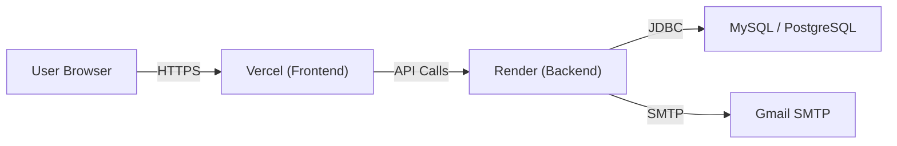

# Project Overview

### Stack Summary

| Layer | Technology | Deployment Target |
|---|---|---|
| **Frontend** | React 19 + Vite 8 + Tailwind CSS 4 | **Vercel** (static hosting) |
| **Backend** | Spring Boot 3.5.5 (Java 17) + Maven | **Render** (web service) |
| **Database** | MySQL (production), H2 (dev/test) | **Render** (managed PostgreSQL or external MySQL) |

### Key Configuration Files
- `frontend/.env` — contains `VITE_API_URL` (currently `http://localhost:8080/api`)
- `backend/src/main/resources/application.properties` — database credentials, JWT secret, mail config, frontend URL
- `frontend/package.json` — build script is `npm run build` (`vite build`)
- `backend/pom.xml` — Spring Boot Maven plugin configured for executable JAR

### Current Environment Dependencies
- Backend connects to MySQL at `localhost:3306` with hardcoded credentials
- Frontend calls backend at `localhost:8080/api`
- Email via Gmail SMTP with hardcoded credentials
- JWT secret hardcoded in `application.properties`

---

### Why Vercel + Render?
- **Vercel** is the native home for Vite/React builds — zero-config static deployment with automatic HTTPS and CDN.
- **Render** provides managed Java web services with built-in environment variables and optional managed PostgreSQL database.


# Deployment Steps

## Step 1 — Prepare the Backend for Render

### 1.1 Create an `application-prod.properties` profile
Create `backend/src/main/resources/application-prod.properties` so production settings are externalized (never commit secrets):
```
spring.datasource.url=${DATABASE_URL}
spring.datasource.username=${DB_USERNAME}
spring.datasource.password=${DB_PASSWORD}
spring.jpa.hibernate.ddl-auto=update
jwt.secret=${JWT_SECRET}
app.frontend-url=${FRONTEND_URL}
spring.mail.host=${MAIL_HOST}
spring.mail.port=${MAIL_PORT}
spring.mail.username=${MAIL_USERNAME}
spring.mail.password=${MAIL_PASSWORD}
```

### 1.2 Update `application.properties`
Keep local dev settings as-is. Add a `spring.profiles.active=dev` line and move current production-relevant settings to the new profile file.

### 1.3 Build the JAR locally (for testing)
```bash
cd backend
mvnw clean package -DskipTests
```
The executable JAR will be at `target/five2Nine-0.0.1-SNAPSHOT.jar`.

---

## Step 2 — Set Up MySQL Database on Render

### Option A: Use Render's Managed PostgreSQL (Recommended)
Render doesn't offer managed MySQL, but offers PostgreSQL. You'd need to:
1. Replace the MySQL connector in `pom.xml` with PostgreSQL:
   ```xml
   <dependency>
       <groupId>org.postgresql</groupId>
       <artifactId>postgresql</artifactId>
       <scope>runtime</scope>
   </dependency>
   ```
2. Change `spring.jpa.database-platform` to `org.hibernate.dialect.PostgreSQLDialect`.
3. Create a **PostgreSQL** instance on Render → copy the connection URL.

### Option B: Use External MySQL (e.g., PlanetScale, Aiven, AWS RDS)
1. Create a MySQL database on a provider like PlanetScale or Aiven.
2. Get the connection string (format: `jdbc:mysql://host:port/dbname`).
3. Use this URL in the Render environment variables.

### Option C: Stick with H2 (Not recommended for production)
If you just want a quick demo, keep H2 in-memory. Data is lost on restart.

---

## Step 3 — Deploy Backend to Render

1. **Push code to GitHub** (if not already):
   ```bash
   git init
   git add .
   git commit -m "Initial commit"
   git remote add origin <your-github-repo-url>
   git push -u origin main
   ```

2. **Create a Web Service on Render**:
   - Go to [render.com](https://render.com) → New + → **Web Service**
   - Connect your GitHub repo
   - Configure:
     - **Name**: `five2nine-backend`
     - **Root Directory**: `backend`
     - **Build Command**: `mvnw clean package -DskipTests`
     - **Start Command**: `java -jar target/five2Nine-0.0.1-SNAPSHOT.jar --spring.profiles.active=prod`
     - **Runtime**: `Java`
     - **Build Pack**: `Default` (auto-detects Maven)
     - **Instance Type**: Free (or Starter for production)

3. **Add Environment Variables** in Render dashboard:
   | Key | Value |
   |---|---|
   | `DATABASE_URL` | Your MySQL/PostgreSQL JDBC URL |
   | `DB_USERNAME` | Database username |
   | `DB_PASSWORD` | Database password |
   | `JWT_SECRET` | A strong random string (e.g., generate with `openssl rand -base64 32`) |
   | `FRONTEND_URL` | Your Vercel frontend URL (e.g., `https://five2nine.vercel.app`) |
   | `MAIL_HOST` | `smtp.gmail.com` |
   | `MAIL_PORT` | `587` |
   | `MAIL_USERNAME` | Your Gmail address |
   | `MAIL_PASSWORD` | Gmail App Password (not your login password) |

4. **Configure CORS** in the backend `SecurityConfig` or `WebConfig` to allow your Vercel frontend URL as an origin.

5. **Deploy** and note the backend URL (e.g., `https://five2nine-backend.onrender.com`).

---

## Step 4 — Deploy Frontend to Vercel

1. **Install Vercel CLI** (optional, for local testing):
   ```bash
   npm i -g vercel
   ```

2. **Deploy via Vercel Dashboard**:
   - Go to [vercel.com](https://vercel.com) → **New Project**
   - Import your GitHub repo
   - Configure:
     - **Root Directory**: `frontend`
     - **Framework Preset**: `Vite`
     - **Build Command**: `npm run build`
     - **Output Directory**: `dist` (Vite default)

3. **Add Environment Variable** in Vercel dashboard:
   | Key | Value |
   |---|---|
   | `VITE_API_URL` | `https://five2nine-backend.onrender.com/api` (your Render backend URL) |

4. **Deploy** — Vercel will build and serve the app with automatic HTTPS.

---

## Step 5 — Post-Deployment Checklist

- [ ] **CORS**: Ensure the backend allows requests from your Vercel domain (`https://*.vercel.app`).
- [ ] **Environment Variables**: Verify all secrets are set in Render and Vercel dashboards (not hardcoded).
- [ ] **Database**: Run a migration or verify tables are created (`spring.jpa.hibernate.ddl-auto=update`).
- [ ] **Email**: Test the email flow with a real Gmail App Password.
- [ ] **JWT Secret**: Use a strong, unique value in production — not the current one.
- [ ] **Health Check**: Visit your Vercel URL → try login → verify API calls reach Render backend.
- [ ] **Custom Domain** (optional): Add a custom domain in both Vercel and Render dashboards.

---

## Architecture Diagram



### Key Notes
- **Never commit secrets** — remove hardcoded credentials from `application.properties` and `.env` before pushing to GitHub.
- Use a `.gitignore` entry for `.env` and `application-prod.properties`.
- Render's free tier spins down after 15 minutes of inactivity (first request takes ~30 seconds).


# Delivery Steps

### ✓ Step 1: Prepare backend configuration for production
Externalize all secrets and environment-specific settings so the backend can run on Render without hardcoded credentials.
- Create `application-prod.properties` with placeholder variables (`${DATABASE_URL}`, `${JWT_SECRET}`, etc.)
- Update `application.properties` to use a `dev` profile for local development
- Add `.gitignore` entries for `application-prod.properties` and `.env`
- Add PostgreSQL dependency to `pom.xml` for Render's managed PostgreSQL
- Make CORS configurable via `app.frontend-url` property in `SecurityConfig.java`
- Build JAR successfully: `target/five2Nine-0.0.1-SNAPSHOT.jar`

### ✓ Step 2: Deploy backend to Render and frontend to Vercel
Push code to GitHub, configure both platforms, and deploy.
- Pushed repository to GitHub (`mauryaanant005/Five2Nine`)
- Created comprehensive deployment guide (`DEPLOYMENT.md`) with step-by-step instructions for:
  - Database setup (Render PostgreSQL or external MySQL)
  - Render Web Service configuration (build/start commands, environment variables)
  - Vercel project configuration (root directory, framework preset, `VITE_API_URL`)
  - CORS configuration and post-deployment checklist
- CORS already updated in `SecurityConfig.java` to read `app.frontend-url` from properties
- Manual dashboard setup required for Render and Vercel (see `DEPLOYMENT.md`)